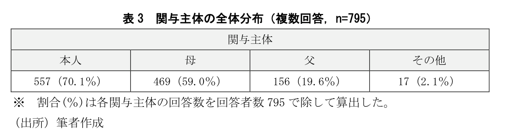
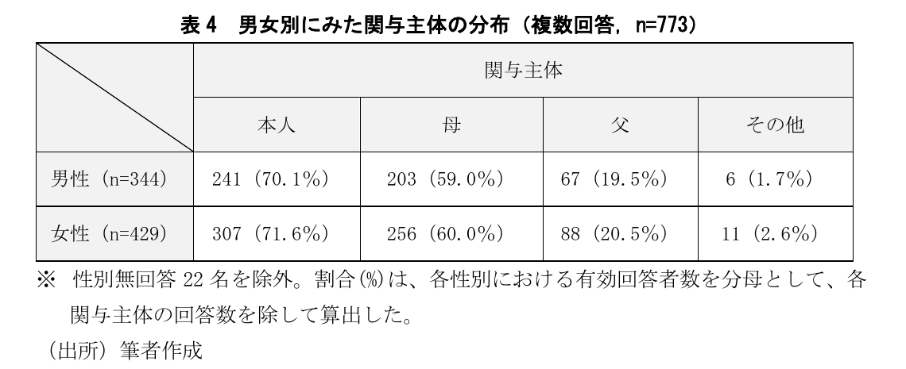
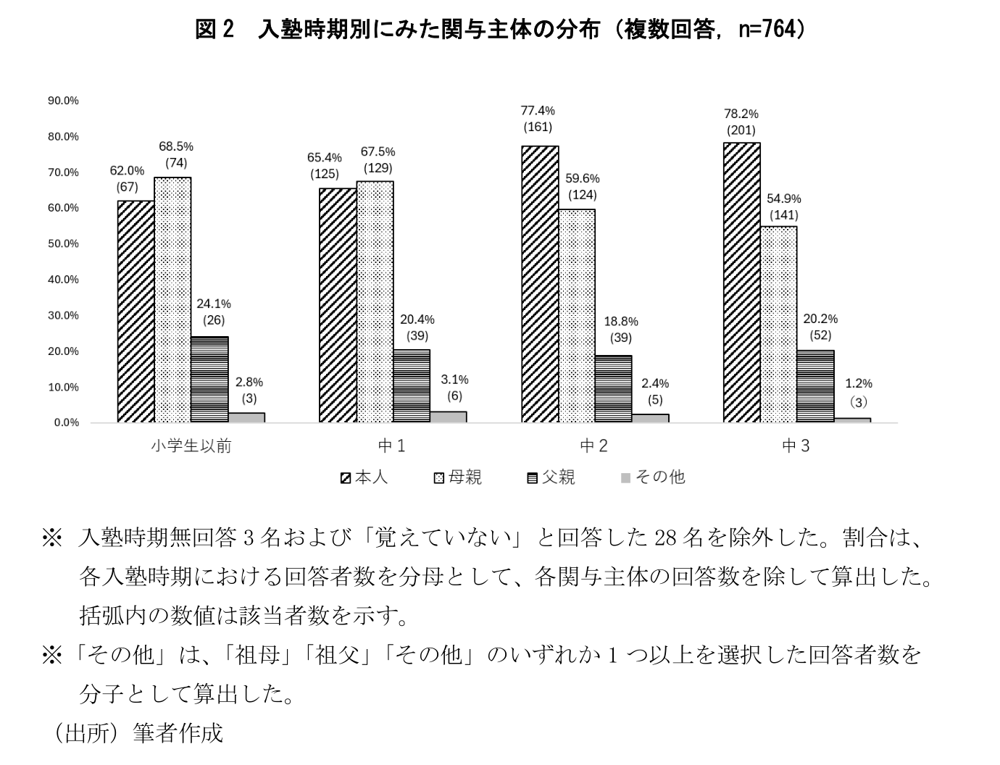
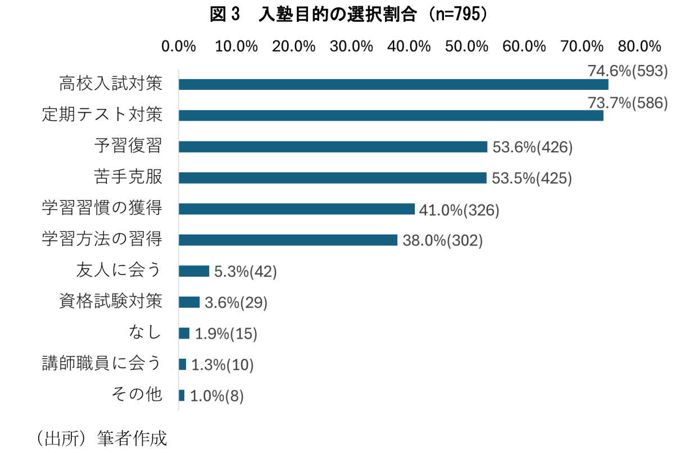
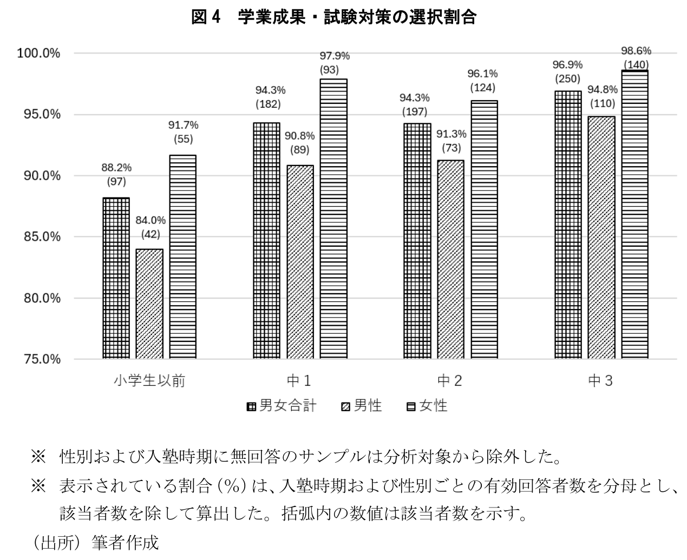
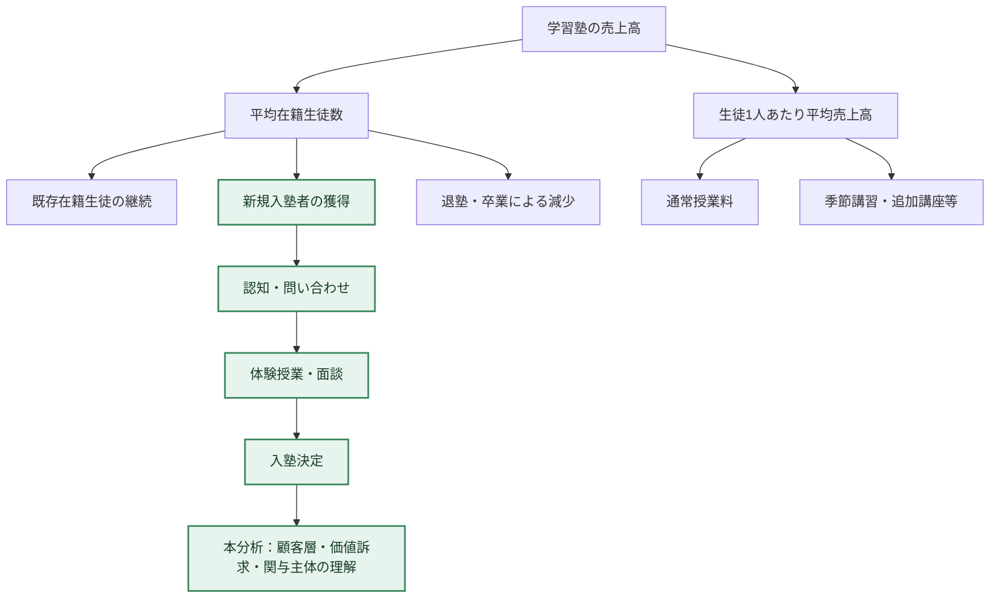

# 01. ビジネス課題と分析上の問い

> **経営課題：新規入塾者を獲得するためのマーケティング施策の最適化**  
> **分析の中心的な問い：どの顧客層に、どのような価値を、誰に向けて訴求すべきか。**

## 1. 修士論文を出発点とするプロジェクト

### 1.1 修士論文の問題意識

本プロジェクトは、修士論文『教育サービス選択における消費者行動論的アプローチ―学習塾選択に関する実証分析―』（2026年）で得られた知見を基礎に、**学習塾の新規入塾者獲得という経営課題に向けて再分析するプロジェクト**である。

同論文では、学習塾を学校教育の補完機関としてだけでなく、**生徒・保護者から選択される教育サービス**として捉え、消費者行動論の観点から、入塾目的、選択時に重視される価値、家族内の意思決定関与、情報探索経路・口コミ行動を探索的に検討した。

研究背景には、少子化による潜在顧客層の縮小と、学習塾事業者が顧客から選ばれ続ける必要性がある。また、教育サービスは利用前に品質や成果を十分に判断しにくく、進学実績・授業内容だけでなく、体験授業、講師との関係、友人の推奨などが選択の手掛かりになる可能性がある。

*参照：修士論文 第1〜3章、第4.1〜4.3節。*

### 1.2 修士論文で得られた主な知見

修士論文では、2025年10月5日に新潟市内の模擬試験会場で実施した、**学習塾に通う中学3年生795人**の質問紙調査を分析した。主な成果は、次の5点に整理できる。

**① 学習塾選択には生徒本人と母親が中心的に関与していた（家族内意思決定）**

学習塾選択に関与したと回答した割合は、**生徒本人70.1%、母親59.0%、父親19.6%** であり、生徒本人と母親が主な関与主体であった（複数回答）。また、入塾時期別にみると、中学1年での入塾者では本人関与65.4%、母親関与67.5%であったのに対し、中学3年での入塾者では本人関与78.2%、母親関与54.9%となった。入塾時期と本人関与、母親関与との間には探索的な統計検定で関連が認められたが、効果量は小さかった。これは、入塾時期によって情報提供の対象や親子の関与状況が異なる可能性を示す結果である。

*修士論文 表3「関与主体の全体分布」（論文26ページ）。全体の関与率を示す。*

性別に分けても、本人・母親・父親の関与率はおおむね同水準であった。論文で実施したχ²検定でも、**本人関与（p=.65）、母親関与（p=.85）、父親関与（p=.72）**のいずれについても、性別との統計的に有意な関連は確認されなかった（5%水準、補正前）。これは性別による差が存在しないことを証明するものではなく、**今回の標本では有意な関連を検出しなかった**ことを意味する。

*修士論文 表4「男女別にみた関与主体の分布」（論文26ページ）。性別無回答22人を除外。検定結果は論文28ページの本文を参照。*

*修士論文 図2「入塾時期別にみた関与主体の分布」（論文27ページ）。入塾時期無回答3人と「覚えていない」28人を除外したため、図の集計対象は764人。*

**② 入塾目的は学業成果・試験対策が中心だが、学習上の課題は一様ではなかった**

入塾目的（複数回答）では、「高校入試対策」74.6%、「定期テスト対策」73.7%が最も多く、「予習・復習」53.6%、「苦手分野の克服」53.5%も半数を超えた。一方、「学習習慣の獲得」41.0%、「学習方法の習得」38.0%も一定の割合を占めた。これは、顧客を単に「成績向上を希望する層」とひとくくりにせず、具体的な学習課題を把握する必要があることを示唆する。

*修士論文 図3「入塾目的の選択割合」（論文29ページ）。複数回答のため割合の合計は100%にならない。*

**《学業成果・試験対策》**

入塾目的を4分類した分析では、**「学業成果・試験対策」は、入塾時期が遅いほど選択割合が高い傾向**がみられた。小学生以前に入塾した層では88.2%であったのに対し、中学3年からの入塾者では96.9%に達した。また、**各入塾時期で女性の選択割合が男性を上回り**、小学生以前の入塾者では女性91.7%・男性84.0%、中学1年からの入塾者では女性97.9%・男性90.8%であった。

*修士論文 図4「学業成果・試験対策の選択割合」（論文30ページ）。入塾時期・性別の無回答者は除外。*

χ²検定では、**入塾時期との関連**（χ²(3)=10.88、p=.012、Cramér's V=.12）および**性別との関連**（χ²(1)=10.43、p=.001、Cramér's V=.12）が、それぞれ5%水準で認められた。ただし、いずれも効果量は小さく、複数項目に対する検定の多重比較補正は行っていない。また、この検定は入塾時期・性別それぞれの全体的な関連を評価したものであり、特定学年における男女差や男女による入塾時期との関連の違い（交互作用）を直接検証したものではない。

**③ 学習塾選択では機能的価値だけでなく、体験的・情緒的価値や社会的価値も選ばれていた**

個別の選択要因では、「近接性」54.3%、「学力向上・進学実績」32.8%、「指導形態」30.2%といった機能的要因が多く挙げられた。一方、「体験授業の印象」27.3%、「学習塾の雰囲気」18.2%などの体験的・情緒的要因、「友人の通塾」24.0%、「親のすすめ」21.5%などの社会的要因も選択されていた。体験的・情緒的価値に分類される項目を1つ以上選択した割合は、女性46.2%、男性31.4%であった。また、消費価値の**3分類の選択パターン全体**と性別との間には統計的な関連が認められた（χ²(7)=20.07、p=.005、Cramér's V=.16）。ただし関連の強さは小さく、特定の性別に一律の価値志向があることを示すものではない。

**④ 友人の推奨や入塾説明など、対人的な情報が選択要因として挙げられた**

情報環境に関する選択要因では、「友人のすすめ」22.9%、「入塾説明」11.2%に対し、「ネット上の口コミ」3.4%、「広告」2.8%、「Webサイト」1.9%であった。これらは**学習塾選択時に重視した要因として挙げられた割合**であり、実際の情報接触率や媒体の集客効果を示すものではない。利用前にサービスの品質・成果を評価しにくい教育サービスでは、対人的・体験的な接点の役割を検討する意義がある。

**⑤ 通塾経験と口コミ・紹介行動にも違いがみられた**

通塾経験について「通常授業」を会話の話題に挙げた者は59.5%と最も多く、その集団での紹介経験割合は51.7%であった。一方、記念品を話題に挙げた者の紹介経験割合は74.1%であった。ただし、記念品の該当者は27人と少なく、記念品が紹介を促したという因果関係を示す結果ではない。学習体験や口コミに着目した施策を検討する際の探索的な手掛かりと位置づけられる。

**これらの知見を踏まえた次の問い**

修士論文は、選択に関与する人、入塾目的、重視される価値、情報環境の特徴を主に個別に整理した。一方、経営者が顧客層別の施策を判断するには、**「どの入塾目的を持つ生徒が、どの価値を組み合わせて重視するのか」「その価値は広く選択されるものか、特定層に特徴的なものか」「家庭教育方針と関与主体はどう関連するか」** を追加的に確認する必要がある。この点を本ポートフォリオの分析1〜3で掘り下げる。

> **解釈上の注意：** 上記は通塾者の自己報告に基づく横断的・回顧的調査の結果である。因果関係や新規入塾率への効果を直接示すものではない。また、割合の分母は設問や欠損処理によって異なる。消費価値分類については、論文とPower BIの集計条件の照合を公開前に行う。

*参照：修士論文 第6章（調査方法）、第7.2節（関与主体）、第7.3節（入塾目的）、第7.4節（消費価値）、第7.5〜7.6節（口コミ・情報環境）、第8章（考察）。*

## 2. 修士論文から追加分析への展開

### 2.1 先行分析で把握したこと

修士論文では、**「誰が選択に関与するか」「どのような目的で通塾するか」「どの価値を重視するか」**について、回答分布や性別・入塾時期との関連を中心に明らかにした。第9章では、入塾時期別の価値訴求や顧客接点の設計に関するマーケティング上の示唆を提示した。

### 2.2 実務に向けて掘り下げたい問い

一方、新規入塾者を獲得するための訴求内容を設計するには、入塾目的と消費価値を別々に見るだけでなく、**両者がどのように組み合わさっているか**を把握する必要がある。

たとえば、学力補完を目的とする生徒が、教室の雰囲気や講師との関係も重視しているならば、学習効果だけでなく学習体験の具体的な伝え方も施策候補となる。また、選択率の高い価値が、必ずしも特定の入塾目的を特徴づけるとは限らない。

さらに、教育サービスでは生徒が利用者、保護者が費用負担者となることが多い。そこで、家庭教育方針と選択への関与主体を併せて見ることにより、**誰に向けた情報提供を検討すべきか**という実務上の問いを深める。

本ポートフォリオでは、修士論文と同一の質問紙調査データを用い、Power BI・DAXによってこれらの追加分析を行う。以下の分析1〜3は、**既存の研究成果を経営上の判断に近づけるための分析**として位置づける。

## 3. 学習塾の収益構造と本分析の位置づけ

### 3.1 売上高を構成する経営ドライバー

学習塾の売上高を概念的に捉えると、在籍生徒数と生徒1人あたり売上高の掛け合わせによって整理できる。在籍生徒数は、新規入塾によって増え、退塾・卒業によって減少するため、**新規入塾者の獲得は売上高を支える経営ドライバーの一つ**となる。

**図1. 学習塾の売上構造と本プロジェクトの対象領域（概念図）**

> この図は経営課題を整理するためのモデルであり、修士論文の実証結果を示したものではない。平均在籍生徒数×1人あたり平均売上高は、同一期間・同一定義で算出する場合の基本的な整理である。各要素の増減効果を本調査で推定したものではない。

### 3.2 今回対象とする意思決定

売上高を高める施策には、継続率の改善、客単価の向上、新規入塾者の獲得など複数の方向性がある。本プロジェクトはこのうち、**新規入塾者獲得に向けたマーケティング施策の設計**を対象とする。

新規入塾者の獲得には、認知・問い合わせ・体験授業・入塾決定といった顧客接点が関係する。その過程で、顧客の入塾目的や価値志向を把握し、適切な価値を伝えることが重要だと考えられる。

ただし、調査には問い合わせ履歴、広告接触履歴、体験授業申込数、入塾転換率などが含まれない。このため、**今回のデータから入塾者数や売上高への効果を直接予測・検証することはできない**。まず顧客理解に基づく施策仮説を構築し、効果測定は追加データを用いる次の段階とする。

## 4. 経営課題：新規入塾者を獲得するためのマーケティング施策の最適化

### 課題A：入塾目的に応じて「何を訴求するか」

入塾目的が異なる顧客に対して同じ訴求内容を用いると、特定の顧客層が求める価値を十分に伝えられない可能性がある。

- **意思決定：** 学業成果、学力補完、学習習慣形成などの目的別に、どの消費価値を訴求候補とするか。
- **対応する分析：** 分析1「入塾目的×消費価値の共起分析」。

### 課題B：広く求められる価値と「特徴的な価値」をどう区別するか

全体の選択率が高い価値は共通訴求として重要である一方、特定の顧客層を特徴づける価値とは限らない。選択率だけで訴求の優先順位を決めないことが必要になる。

- **意思決定：** 共通訴求と顧客セグメント別訴求をどのように組み合わせるか。
- **対応する分析：** 分析2「目的内カバー率（普及度）×共起リフト（特徴度）」。

### 課題C：生徒・保護者の「誰に伝えるか」

教育サービスの利用者は生徒であり、費用負担や選択には保護者も関与しうる。家庭教育方針と関与状況を理解することは、体験授業や入塾説明の設計に役立つ可能性がある。

- **意思決定：** 生徒本人・保護者にどのような情報を提供するか。
- **対応する分析：** 分析3「家庭教育方針×消費価値・意思決定関与」。

これらは本プロジェクトで設定した**経営課題の仮説**であり、特定の学習塾における課題を経営者へのヒアリング等で確認したものではない。

## 5. 分析上の問いと評価指標

| 分析 | 分析上の問い | 主な指標 | 意思決定への接続 |
| --- | --- | --- | --- |
| **分析1：入塾目的×消費価値** | 特定の入塾目的と価値はどの程度共起するか | 実測共起率、期待共起率、共起リフト | 目的別の価値訴求候補を見つける |
| **分析2：普及度×特徴度** | 広く選択される価値と、特定層に特徴的な価値は異なるか | 目的内カバー率、共起リフト、属性別比較 | 共通訴求とセグメント別訴求を区別する |
| **分析3：家庭教育方針と意思決定** | 家庭教育方針によって価値選択や関与主体は異なるか | V選択率、P選択率、本人・母親・父親関与率 | 情報提供の対象・内容を検討する |

### 指標の定義

- **目的内カバー率：** ある入塾目的Pを選んだ回答者のうち、消費価値Vも選んだ割合（`n(P∩V) / n(P)`）。
- **共起リフト：** 目的内カバー率を分析対象集団のV選択率で割った値（`P(V|P) / P(V)`）。1を超えると、その集団の基準選択率より高い共起を示す。
- **関与率：** 意思決定に本人・母親・父親等が関与したと回答した割合。複数回答のため、各主体の割合は合計100%にならない。

## 6. 調査データ・分析範囲・公開上の注意

### 6.1 データの概要

- **調査実施日：** 2025年10月5日
- **調査場所：** 新潟市内の複数の模擬試験会場
- **調査対象：** 学習塾に通う中学3年生
- **有効回答：** 795人（配布837部、回収814部、著しい回答欠落19部を除外）
- **主な変数：** 入塾目的（P1〜P4）、消費価値（V1〜V3）、性別、入塾時期、学習塾規模、家庭教育方針、意思決定関与主体
- **分析環境：** Power BI、DAX。統計的検証は元データの整数集計との照合を行い、結果を確定する。

### 6.2 分析の限界

1. **標本の制約：** 新潟市の模擬試験受験者かつ通塾者に限定されるため、全国の生徒や未入塾の見込み顧客を代表しない。
2. **調査設計の制約：** 中学3年生への横断的・回顧的調査であり、入塾時期別の差を同一個人の発達的変化とみなせない。
3. **因果・効果検証の制約：** 共起や関与率から、特定の訴求が入塾率・売上高を高めるとはいえない。
4. **分類・統計の制約：** 消費価値分類は操作的定義による探索的なものである。少人数群、多重比較、概念的に重なる項目には注意する。
5. **データ整合性：** 論文とPower BIの集計条件・価値分類・欠損処理が一致するか、公開前に照合する。
6. **二次利用と公開許諾：** 当初の調査では研究目的に限定した利用を説明している。個票や小集団の集計、図表などを公開する前に、当初の同意内容と調査許可の範囲を確認する。未確認のデータは公開しない。

### 6.3 施策効果の将来的な検証

訴求仮説を実務で検証するには、問い合わせ数、体験授業申込率、体験からの入塾転換率、顧客獲得単価など、顧客接点ごとのデータが追加で必要となる。施策の優先順位や投資対効果は、そのデータを得た段階で評価する。

## 7. 関連する分析レポート

- [分析1：入塾目的と消費価値の共起分析](02_purpose_value.md)
- [分析2：消費価値の普及度と特徴度](03_coverage_lift.md)
- [分析3：家庭教育方針と家族内意思決定](04_family_decision.md)
- [総合考察・マーケティング施策提案](05_marketing_strategy.md)

※ 各レポートへのリンクは該当ファイル公開後に利用できる。

---

### 本ファイルの参照資料

修士論文『教育サービス選択における消費者行動論的アプローチ―学習塾選択に関する実証分析―』（2026年）。主な参照箇所：第2章（研究背景）、第3.6節（教育サービスにおけるマーケティング理論）、第4章（研究目的）、第6章（調査方法）、第7〜9章（分析結果・考察・示唆）、第10章（限界）。
