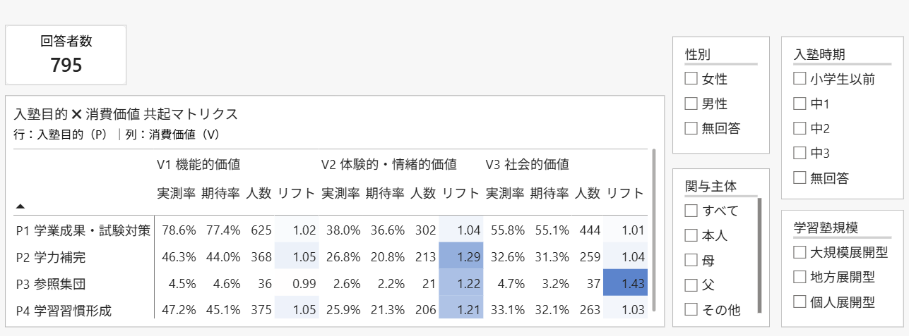

# 02. 分析1：入塾目的と消費価値の共起分析

> **分析上の問い：入塾目的によって、学習塾選択時に重視される消費価値はどのように異なるのか。**  
> 経営課題：新規入塾者を獲得するためのマーケティング施策の最適化

[← 01. ビジネス課題と分析上の問い](01_business_problem.md)

## 1. 分析結果の要約

- 機能的価値（V1）は、いずれの入塾目的とも高い割合で同時に選択されるが、共起リフトは0.99〜1.05であり、特定目的に偏らない基盤的な価値と考えられる。
- 学力補完（P2）と体験的・情緒的価値（V2）のリフトは1.29、学習習慣形成（P4）とV2は1.21であった。両者は全体集計に対する探索的な統計検定でも正の関連を示した。
- 参照集団（P3）と社会的価値（V3）はリフト1.43と最大であった。ただし、P3選択者は44人であり、概念の近さや分類定義にも注意を要する。

これらの結果から、機能的価値を基本としつつ、学力補完や学習習慣形成を求める顧客には体験的・情緒的価値を組み合わせた訴求を試すという施策仮説が考えられる。なお、本稿の検定はPower BIの集計人数からの再計算であり、元データとの照合および公開許可の確認を要する。

## 2. 分析の背景と目的

### 2.1 修士論文で得られた知見と追加分析の必要性

修士論文では、入塾目的を4分類、学習塾選択時に重視される消費価値を3分類に整理し、それぞれについて性別および入塾時期との関連を分析した。

その結果、入塾目的では学業成果・試験対策が中心である一方、学力補完や学習習慣形成も一定の割合を占めることが確認された。

また、学習塾選択においては、機能的価値を基盤としながら、体験的・情緒的価値や社会的価値も重視されていることが示された。

しかし、入塾目的と消費価値を個別に分析するだけでは、特定の入塾目的を持つ顧客が、どのような消費価値を特徴的に重視しているのかを十分に把握することはできない。

例えば、学力補完を目的とする顧客と、学習習慣形成を目的とする顧客では、学習塾を選択する際に重視する価値が異なる可能性がある。

このような違いを把握することは、顧客のニーズに応じた価値訴求や、体験授業、入塾説明などの生徒募集施策を検討するうえで重要である。

そこで本分析では、修士論文で個別に分析した入塾目的と消費価値を直接関連づけ、両者の共起関係を分析する。

### 2.2 経営上の課題と分析上の問い

新規入塾者の獲得に向けたマーケティング施策を検討する際、すべての顧客に対して同一の価値を訴求するのではなく、顧客が抱える学習課題や入塾目的に応じて訴求内容を調整することが考えられる。

そこで、以下の分析上の問いを設定する。

**Q1：入塾目的によって、学習塾選択時に重視される消費価値はどのように異なるのか。**

さらに、以下の観点から分析を行う。

- 特定の入塾目的にかかわらず、幅広く選択される消費価値は何か。
- 特定の入塾目的と特徴的に共起する消費価値は何か。
- 入塾目的と消費価値の共起関係は、性別、入塾時期、学習塾の展開規模によってどのように異なるのか。

### 2.3 共起リフトを用いる理由

入塾目的と消費価値の関連を把握する方法として、共起人数や実測共起率を比較する方法が考えられる。

しかし、選択率が高い入塾目的や消費価値は、両者の間に特別な関連がなくても、同時に選択される割合が高くなりやすい。

そのため、実測共起率のみでは、各項目の選択率の高さによる共起と、特定の入塾目的と消費価値の特徴的な共起を区別することが難しい。

そこで本分析では、入塾目的と消費価値が互いに独立であると仮定した場合の期待共起率を算出し、実測共起率との比である共起リフトを用いる。

これにより、各項目の選択率を考慮したうえで、期待水準を上回る特徴的な共起関係を把握する。

### 2.4 本分析の到達点

本分析では、入塾目的と消費価値の共起関係を可視化し、顧客ニーズに応じた価値訴求を検討するための基礎的な知見を得ることを目的とする。

得られた知見は、後続の分析2「普及度と特徴度の比較」および生徒募集のマーケティング施策の立案に活用する。

なお、本分析は既存通塾者を対象とした横断的・回顧的な調査データに基づくものである。そのため、共起関係は顧客の選択傾向を示すものであり、特定の価値訴求による新規入塾者数の増加を直接実証するものではない。

## 3. データと変数の定義

2025年10月5日、新潟市内の新潟県統一模試会場で収集した、学習塾に通う中学3年生の有効回答795人を対象とする。複数回答を分類ごとの選択有無（0/1）として扱う。各分類は排他的ではない。

### 3.1 入塾目的（P）

| コード | 分類 | 主な構成項目 | 該当人数 |
|---|---|---|---:|
| P1 | 学業成果・試験対策 | 高校入試対策、定期テスト対策、予習・復習、資格試験対策 | 747 |
| P2 | 学力補完（苦手克服） | 苦手分野の克服 | 425 |
| P3 | 参照集団の影響 | 友人に会う、講師・職員に会う | 44 |
| P4 | 学習習慣形成 | 学習習慣の獲得、学習方法の習得 | 435 |

### 3.2 消費価値（V）

| コード | 分類 | 主な項目例 | 該当人数 |
|---|---|---|---:|
| V1 | 機能的価値 | 近接性、学力向上・進学実績、指導形態、指導の上手さ、月謝など | 655 |
| V2 | 体験的・情緒的価値 | 体験授業の印象、学習塾の雰囲気、講師・職員の人柄 | 310 |
| V3 | 社会的価値 | 友人の通塾、親のすすめ、兄弟姉妹の通塾など | 466 |

分類は修士論文の操作的定義（第6.5節、第7.3節）を出発点とする。人数は今回のPower BI分析における集計値である。V3については修士論文との集計整合性が未確認のため、上記項目は例示にとどめ、最終的な採用項目・集計条件を確定後に明記する。情報環境項目は主分析とは区別する。

## 4. 分析方法

### 4.1 共起指標の定義

回答者数を N、目的Pの該当者数を n(P)、価値Vの該当者数を n(V)、両者を選択した人数を n(P∩V) とする。

| 指標 | 計算式 | 解釈 |
|---|---|---|
| 共起人数 | n(P∩V) | 両方を選択した人数 |
| 実測共起率 | n(P∩V) / N | 両方を選択した回答者の割合 |
| 期待共起率 | (n(P) / N) × (n(V) / N) | 両者が独立である場合の期待割合 |
| 共起リフト | 実測共起率 / 期待共起率 | 期待水準に対する実測値の比 |

リフト1は独立の場合の期待水準、1超は期待より多い共起、1未満は期待より少ない共起を表す。リフトは関連の指標であり、因果関係や入塾確率を示すものではない。

例えばP2×V2では、共起人数213人、実測共起率26.79%、期待共起率20.85%、リフト1.29となる。独立を仮定した水準に対して約29%多く共起していることを意味する（29ポイント増加ではない）。

### 4.2 Power BIによる可視化

行に入塾目的、列に消費価値を配置したマトリクスを作成し、DAXで共起指標を算出した。共起リフトの条件付き書式と、性別・入塾時期・関与主体・学習塾規模のスライサーを利用して分析対象を切り替えられるようにした。

DAXの主要な計算ロジック：

```dax
期待共起率 =
VAR _N = [回答者数]
VAR _PRate = DIVIDE([P該当者数], _N)
VAR _VRate = DIVIDE([V該当者数], _N)
RETURN _PRate * _VRate

共起リフト = DIVIDE([実測共起率], [期待共起率])
```

各集団の回答者数を分母とし、その集団内のP・V選択率から期待値を算出する。

## 5. 分析結果（全体 n=795）



*図1：Power BIの分析1画面（全体、スライサーによる絞り込みなし）。実測・期待共起率、共起人数、リフトを表示。*

### 5.1 共起リフトの比較

| 入塾目的 | V1 機能的 | V2 体験的・情緒的 | V3 社会的 |
|---|---:|---:|---:|
| P1 学業成果・試験対策 | 1.02 | 1.04 | 1.01 |
| P2 学力補完 | 1.05 | **1.29** | 1.04 |
| P3 参照集団 | 0.99 | 1.22 | **1.43** |
| P4 学習習慣形成 | 1.05 | **1.21** | 1.03 |

### 5.2 実測共起率・期待共起率・共起人数

| 組み合わせ | 共起人数 | 実測率 | 期待率 | リフト |
|---|---:|---:|---:|---:|
| P1×V1 | 625 | 78.62% | 77.42% | 1.02 |
| P1×V2 | 302 | 37.99% | 36.64% | 1.04 |
| P1×V3 | 444 | 55.85% | 55.08% | 1.01 |
| P2×V1 | 368 | 46.29% | 44.04% | 1.05 |
| P2×V2 | 213 | 26.79% | 20.85% | 1.29 |
| P2×V3 | 259 | 32.58% | 31.34% | 1.04 |
| P3×V1 | 36 | 4.53% | 4.56% | 0.99 |
| P3×V2 | 21 | 2.64% | 2.16% | 1.22 |
| P3×V3 | 37 | 4.65% | 3.24% | 1.43 |
| P4×V1 | 375 | 47.17% | 45.08% | 1.05 |
| P4×V2 | 206 | 25.91% | 21.34% | 1.21 |
| P4×V3 | 263 | 33.08% | 32.07% | 1.03 |

### 5.3 結果の解釈

**V1：幅広い入塾目的に共通する価値**

V1は全体で655人（82.4%）が選択している。各目的とのリフトはほぼ1であり、特定の入塾目的だけを特徴づけるよりも、顧客に共通する訴求の基盤と考えられる。

**V2：学力補完・学習習慣形成との関連**

P2×V2は213人、P4×V2は206人で、比較的多くの回答者が該当している。リフトもそれぞれ1.29、1.21と期待水準を上回っており、目的に応じた体験的・情緒的価値の訴求を検討する手掛かりとなる。

P3×V2もリフト1.22であるが共起人数は21人であり、後述の検定では有意な関連は確認されなかった。

**V3：参照集団との特徴的な共起**

P3×V3は37人、リフト1.43で最大であった。友人・講師との交流を入塾目的とする回答者と、社会的要因を重視する回答者との関連を示唆する。ただしP3の人数は44人であり、またP3とV3は概念的に近い。V3の集計定義も照合を要するため、施策の優先順位をリフトのみで判断しない。

## 6. 属性別の探索的比較

Power BIのスライサーを利用し、性別・入塾時期・学習塾規模別に共起リフトを確認した。以下はP2・P4とV2の主な結果である。

| 属性 | n | P2×V2 | P4×V2 |
|---|---:|---:|---:|
| 女性 | 429 | 1.18 | 1.19 |
| 男性 | 344 | 1.42 | 1.26 |
| 小学生以前 | 116 | 1.36 | 1.10 |
| 中1 | 197 | 1.45 | 1.44 |
| 中2 | 213 | 1.16 | 1.21 |
| 中3 | 266 | 1.25 | 1.10 |
| 大規模展開型 | 375 | 1.18 | 1.09 |
| 地方展開型 | 231 | 1.46 | 1.34 |
| 個人展開型 | 189 | 1.35 | 1.40 |

性別は無回答22人、入塾時期は無回答3人を除く。中1入塾者でP2・P4×V2のリフトが比較的高く、地方展開型のP2×V2、個人展開型のP4×V2にも特徴的な共起がみられた。ただし、各集団のV2選択率が異なるため、リフトの高さはその価値の選択割合の高さを直接意味しない。群間の交互作用も未検証である。

この点を掘り下げるため、分析2では目的内カバー率とリフトを併せて比較する。

## 7. 統計的検証（全体集計からの再計算）

各P×Vの組み合わせについて、次の2×2分割表を作り、Pearsonのχ²検定（自由度1、Yates補正なし）で独立性を検討した。

| | V選択あり | V選択なし |
|---|---:|---:|
| P選択あり | a | n(P)−a |
| P選択なし | n(V)−a | N−n(P)−n(V)+a |

ここで a=n(P∩V)。効果量には符号付きφ係数（2×2表の関連方向を含む指標）を用い、12検定を一つの検定族としてHolm法による多重比較補正を行った。

| 組み合わせ | χ² | p値 | Holm補正後p値 | φ |
|---|---:|---:|---:|---:|
| P1×V1 | 13.93 | 0.00019 | 0.0019 | 0.132 |
| P1×V2 | 10.70 | 0.00107 | 0.00748 | 0.116 |
| P1×V3 | 3.44 | 0.0636 | 0.318 | 0.066 |
| P2×V1 | 11.09 | 0.000866 | 0.00693 | 0.118 |
| P2×V2 | 47.50 | 5.5e-12 | 6.6e-11 | 0.244 |
| P2×V3 | 2.03 | 0.154 | 0.615 | 0.051 |
| P3×V1 | 0.01 | 0.918 | 0.918 | -0.004 |
| P3×V2 | 1.49 | 0.222 | 0.665 | 0.043 |
| P3×V3 | 12.46 | 0.000416 | 0.00374 | 0.125 |
| P4×V1 | 9.65 | 0.0019 | 0.0114 | 0.110 |
| P4×V2 | 28.24 | 1.07e-07 | 1.18e-06 | 0.188 |
| P4×V3 | 1.35 | 0.246 | 0.665 | 0.041 |

補正後5%水準では12組中7組に有意な関連が認められた。P2×V2（φ=.244）とP4×V2（φ=.188）の効果量は他の組み合わせより大きいが、強い関連とまではいえない。P1×V1・V2などは有意でもリフトは1に近く、統計的有意性と実務的な特徴度を区別する必要がある。

検定は表示されていた共起人数・周辺人数に基づいて再計算した暫定結果である（Python、SciPy `chi2_contingency(correction=False)`、statsmodels `multipletests(method="holm")`）。元の回答者別データ、分類定義、欠損処理を照合後に確定する。

## 8. 生徒募集施策への示唆

| 対象の候補 | 分析根拠 | 施策仮説 |
|---|---|---|
| 幅広い入塾目的層 | V1の高い選択率、リフトは1前後 | 指導内容、学習成果、通塾の利便性を基本情報として提示する |
| 学力補完を希望する層 | P2×V2 リフト1.29 | 苦手単元を対象とした体験授業を行い、質問のしやすさや講師との相性を伝える |
| 学習習慣形成を希望する層 | P4×V2 リフト1.21 | 学習計画の作成・学習相談などを体験できる機会を設計し、継続支援の内容を伝える |

これらは顧客層ごとの価値提案の仮説であり、各施策が新規入塾者数を増やすことが実証されたわけではない。例えば、学力補完を求める顧客向けに機能的価値のみの訴求と体験的・情緒的価値を加えた訴求を比較し、問い合わせ率・体験申込率・入塾転換率などで検証することが考えられる。

## 9. 分析の限界と次の分析

- 横断的・回顧的な自己報告であり、因果関係は推定できない。
- 新潟市内の模試受験者かつ既存通塾者に限定され、未入塾者や潜在市場の代表性は保証されない。
- 複数回答のため目的層は重複する。排他的な顧客セグメントではない。
- 属性別のリフト差について統計的な群間比較は実施していない。少人数層は慎重に解釈する。
- V3の集計について、修士論文表9（入塾時期有効回答792人で478人という記載）とPower BI全体（795人で466人）が一致していない。分類・集計条件と論文表内の整合性を元データで照合し、影響する指標を再計算する。
- 調査時には研究目的以外の使用を行わない旨の説明がなされている。ポートフォリオへの二次利用・集計結果の公開について許可範囲を確認するまでは非公開の下書きとして扱う。個票データは掲載しない。

次の分析2では、共起リフトに目的内カバー率を加え、広く選択される価値と特定目的に特徴的な価値を区別する。これにより、訴求内容の優先順位を検討する。

## 10. 参照資料

- 筆者（2026）『教育サービス選択における消費者行動論的アプローチ―学習塾選択に関する実証分析―』第6章、第7.3〜7.4節、第9章。
- 筆者作成 Power BI「入塾目的×消費価値 共起マトリクス」（全体および属性別集計）。
- 本稿の統計検定：上記Power BIの全体集計人数に基づく再計算。
