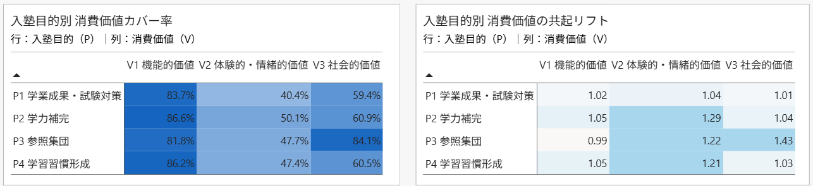
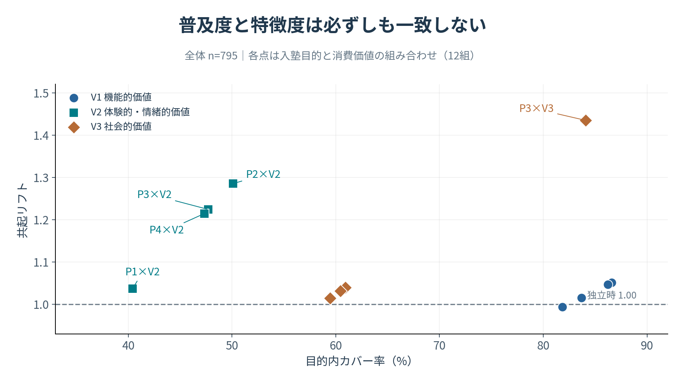
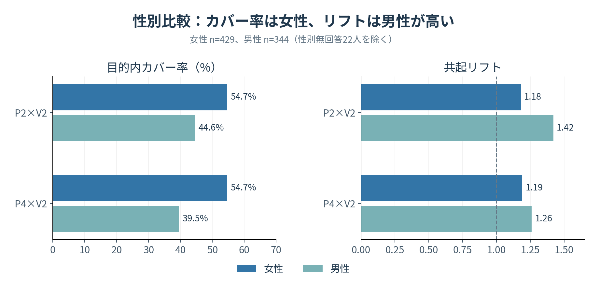

# 03. 分析2：消費価値の普及度と特徴度の比較

> **分析上の問い（Q2）：広く選択される消費価値と、特定の入塾目的を持つ顧客に特徴的な消費価値は何か。**  
> 経営課題：新規入塾者を獲得するためのマーケティング施策の最適化

[← 02. 入塾目的と消費価値の共起分析](02_purpose_value.md) ｜ [トップページ](../README.md)

## 1. 分析結果の要約

- 機能的価値（V1）の目的内カバー率は81.8〜86.6%であり、共起リフトは0.99〜1.05であった。特定目的に特化するよりも、幅広い目的層に共通する訴求の基盤として検討できる。
- 体験的・情緒的価値（V2）は、学力補完（P2）でカバー率50.1%、リフト1.29、学習習慣形成（P4）で47.4%、1.21であった。一定の普及度と期待水準以上の共起を併せ持つため、目的別の追加訴求候補となる。
- P2・P4×V2では、女性の方が目的内カバー率が高い一方、男性の方が共起リフトが高かった。中1入塾者や地方・個人展開型でも、カバー率とリフトの順位は必ずしも一致しなかった。

以上から、**価値の普及度と特徴度を区別し、該当人数も含めて訴求内容の優先順位を検討する**ことが重要である。なお、属性別の差は記述的な比較であり、施策効果や群間差を統計的に実証したものではない。

## 2. 分析の背景と目的

分析1では、入塾目的（P）と消費価値（V）の関係を共起リフトによって把握した。しかし、リフトが高いという事実は、必ずしも多くの顧客がその価値を選択していることを意味しない。

生徒募集施策を検討するためには、ある価値が特定の目的層で特徴的に選ばれているかに加え、その目的層のうちどの程度の顧客が選択しているのかを把握する必要がある。

そこで分析2では、共起リフト（特徴度）に目的内カバー率（普及度）を加え、基本的な訴求価値と目的別の追加訴求価値を検討する。さらに性別・入塾時期・学習塾の展開規模による違いを探索する。

| | 分析1 | 分析2 |
|---|---|---|
| 主な目的 | 目的と価値の特徴的な関連を発見する | 訴求価値の候補を評価する |
| 主な指標 | 共起率・共起リフト | 目的内カバー率・共起リフト・該当人数 |
| 経営への応用 | 何を訴求するか | 何を優先して訴求するか |

## 3. データと分析方法

分析対象は分析1と同じ、2025年10月5日に新潟市内の模擬試験会場で調査した既存通塾者（中学3年生）795人である。入塾目的・消費価値は複数回答を分類別の二値変数に加工したものであり、目的層は排他的ではない。

| コード | 定義 | 全体該当人数 |
|---|---|---:|
| P1 | 学業成果・試験対策 | 747 |
| P2 | 学力補完 | 425 |
| P3 | 参照集団 | 44 |
| P4 | 学習習慣形成 | 435 |
| V1 | 機能的価値 | 655 |
| V2 | 体験的・情緒的価値 | 310 |
| V3 | 社会的価値 | 466 |

分類の詳細およびデータ品質上の確認事項は[分析1の第3章](02_purpose_value.md)を参照。人数は現在のPower BI集計に基づく暫定値である。

### 3.1 普及度と特徴度の定義

回答者数を N、目的Pの該当人数を n(P)、価値Vの該当人数を n(V)、共起人数を n(P∩V) とする。

| 指標 | 算出方法 | 解釈 |
|---|---|---|
| 目的内カバー率（普及度） | n(P∩V) / n(P) | 目的Pの選択者のうち価値Vも選択した割合 |
| 価値の全体選択率 | n(V) / N | 分析対象全体で価値Vを選択した割合 |
| 共起リフト（特徴度） | 目的内カバー率 / 価値の全体選択率 | 独立時の期待水準に対する比 |
| 共起人数 | n(P∩V) | 両者に該当する実際の人数 |

共起リフトは分析1で用いた「実測共起率 / 期待共起率」と代数的に等しい。属性別に分析するときは、各属性の集団内で分母と基準選択率を算出する。

例えば、P2×V2では、共起人数213人、P2選択者425人、V2選択者310人である。

- 目的内カバー率：213 ÷ 425 ≒ 50.1%
- 全体のV2選択率：310 ÷ 795 ≒ 39.0%
- リフト：(213 ÷ 425) ÷ (310 ÷ 795) ≒ 1.29

これはP2選択者の約半数がV2を選択し、その割合が全体のV2選択率の約1.29倍であることを示す。新規顧客の獲得確率を示すものではない。

### 3.2 Power BIによる可視化

入塾目的を行、消費価値を列とする2種類のマトリクスを並べ、目的内カバー率と共起リフトを比較した。性別・入塾時期・関与主体・学習塾規模のスライサーで対象集団を切り替えられる。

既存のDAXメジャーを利用した計算ロジックは以下の通りである。

```dax
目的内カバー率 =
DIVIDE([実測共起率] * [回答者数], [P該当者数])

共起リフト =
DIVIDE([実測共起率], [期待共起率])
```

目的内カバー率はパーセント表示とし、該当目的の選択者が0人の場合は `DIVIDE` の既定の空白値を使用する。対象人数はスライサーによる絞り込み後の人数を用いる。

## 4. 全体の分析結果（n=795）



*図1：著者作成のPower BI分析2画面（全体・絞り込みなし）のマトリクス部分。左は普及度、右は特徴度。*

各セルは「目的内カバー率 / 共起リフト」を示す。

| 入塾目的 | V1 機能的 | V2 体験的・情緒的 | V3 社会的 |
|---|---:|---:|---:|
| P1（747人） | 83.7% / 1.02 | 40.4% / 1.04 | 59.4% / 1.01 |
| P2（425人） | 86.6% / 1.05 | **50.1% / 1.29** | 60.9% / 1.04 |
| P3（44人） | 81.8% / 0.99 | 47.7% / 1.22 | **84.1% / 1.43** |
| P4（435人） | 86.2% / 1.05 | **47.4% / 1.21** | 60.5% / 1.03 |



*図2：Power BIの全体集計人数から作成した散布図。破線はリフト1.00（独立時の期待水準）を示す。近接する点は一部重なる。*

### 4.1 機能的価値は普及度が高いが、特徴度は限定的

V1は全体の82.4%が選択しており、目的内カバー率も全目的で80%以上である。一方、共起リフトは1前後に集中している。したがって、機能的価値は特定の目的層だけを特徴づけるものではなく、幅広い顧客への基本的な訴求候補と考えられる。

### 4.2 P2・P4×V2は追加訴求の候補となる

P2×V2は213人、P4×V2は206人であり、両者とも目的内カバー率は約半数、リフトは1を上回る。P1×V2（40.4%、1.04）と比較して、目的に応じた体験的・情緒的価値の訴求を検討する手掛かりとなる。ただしP2とP4は重複し得るため、共起人数の合計を顧客数としては扱わない。

### 4.3 P3×V3は高い普及度・特徴度を示すが、対象人数が小さい

P3×V3はカバー率84.1%、リフト1.43と高い一方、共起人数は37人、目的選択者は44人に限られる。P3とV3の概念上の近さにも注意が必要である。高いカバー率とリフトのみを理由に、全体の生徒募集施策で最優先と判断することはできない。

## 5. 属性別の比較：P2・P4×V2に着目

以下はPower BIの属性別画面から転記した記述統計である。nは各集団の全回答者数であり、カバー率の分母となる目的選択者数とは異なる。分析軸ごとの比較であり、性別・入塾時期・規模を同時に調整した結果ではない。

### 5.1 性別：女性のカバー率、男性のリフトが高い

| 性別 | n | P2×V2 カバー率 | リフト | P4×V2 カバー率 | リフト |
|---|---:|---:|---:|---:|---:|
| 女性 | 429 | 54.7% | 1.18 | 54.7% | 1.19 |
| 男性 | 344 | 44.6% | 1.42 | 39.5% | 1.26 |

*性別無回答22人を除外。*



*図3：Power BIの性別別集計値から作成。*

P2・P4のいずれでも、女性のカバー率が男性を上回る。一方、リフトは男性の方が高い。表示値から概算した各性別のV2基準選択率は女性約46%、男性約31%であり、基準水準が低い男性では目的別の相対的な上昇が目立つ。

したがって、男性の方がV2を多く重視すると解釈してはならない。女性では実際の選択割合が高く、男性では各性別の基準に対する特徴度が高い。性別のみで訴求を変えるのではなく、学力補完・学習習慣形成などのニーズを起点とした訴求を施策候補とする。

### 5.2 入塾時期：中1入塾者のリフトが高い

| 入塾時期 | n | P2×V2 カバー率 | リフト | P4×V2 カバー率 | リフト |
|---|---:|---:|---:|---:|---:|
| 小学生以前 | 116 | 49.2% | 1.36 | 39.7% | 1.10 |
| 中1 | 197 | 51.6% | **1.45** | 51.0% | **1.44** |
| 中2 | 213 | 47.5% | 1.16 | 49.6% | 1.21 |
| 中3 | 266 | 51.3% | 1.25 | 45.2% | 1.10 |

*入塾時期無回答3人を除外。*

中1入塾者ではP2・P4×V2のリフトがともに最も高い。一方、P2×V2のカバー率は中1（51.6%）と中3（51.3%）でほぼ同じである。P4×V2についても中2（49.6%）は中1（51.0%）に近い。

中1向けの募集では、学習課題に応じた体験授業・学習相談を訴求候補として検討できる。ただし、現在の中3が過去の入塾時点について回答した結果であり、現在の中1の需要を直接測定したものではない。

### 5.3 学習塾規模：カバー率とリフトで順位が異なる

| 学習塾規模 | n | P2×V2 カバー率 | リフト | P4×V2 カバー率 | リフト |
|---|---:|---:|---:|---:|---:|
| 大規模展開型 | 375 | 53.1% | 1.18 | 48.8% | 1.09 |
| 地方展開型 | 231 | 53.8% | **1.46** | 49.2% | 1.34 |
| 個人展開型 | 189 | 40.7% | 1.35 | 42.2% | **1.40** |

地方展開型と大規模展開型のP2×V2カバー率はほぼ同じだが、地方展開型の方がリフトは高い。個人展開型ではP4×V2のリフトが最も高いものの、カバー率は3規模の中で最も低い。各規模におけるV2の基準選択率の違いが、この順位の違いに関係している。

地方展開型では苦手克服と体験的・情緒的価値、個人展開型では学習習慣形成と体験的・情緒的価値を組み合わせる訴求を試す余地がある。ただし、規模間の群間差や競合優位性を実証した結果ではない。

## 6. 生徒募集施策への示唆

普及度は対象目的層での選択割合、特徴度は基準選択率に対する相対的な関連を表す。これらに目的選択者数・共起人数を加味して、訴求候補を次のように整理する。以下は優先順位の定性的な検討であり、一律の数値閾値や収益性による順位付けではない。

| 訴求の位置づけ | 分析根拠 | 施策仮説 |
|---|---|---|
| 基本訴求 | V1：全目的でカバー率80%以上、リフト1前後 | 指導内容・実績・通塾の利便性などの基本情報を提示 |
| 目的別の追加訴求 | P2・P4×V2：カバー率約半数、リフト1超、共起人数200人超 | 苦手克服の体験授業、質問しやすさ、講師との相性、学習相談などを試す |
| 限定的な訴求候補 | P3×V3：高カバー率・高リフトだが37人 | 友人との体験機会などを小規模に検証する |

例えば、学力補完を希望する見込み顧客に対して、指導内容を中心とした案と、指導内容に講師との関係や教室の雰囲気を加えた案を比較する。問い合わせ率、体験授業申込率、入塾転換率、顧客獲得単価などにより施策効果を検証する。今回のアンケートにはこれらの成果指標が含まれていないため、別途収集が必要である。

## 7. 分析の限界と次の分析

- 既存通塾者を対象とした横断的・回顧的調査であり、未入塾者の市場規模、入塾確率、施策の因果効果は測定できない。
- 複数回答のため目的層は重複する。排他的な顧客セグメントとして扱わない。
- 属性別のリフトは各集団の基準選択率に依存する。群間差の統計的検定、交絡要因の調整は未実施である。少人数層の高い値には特に注意する。
- 分析1で指摘したV1・V3の論文内・Power BI間の集計整合性について、元データで確認し、必要に応じて本分析も再計算する。
- 調査時の研究目的に関する説明を踏まえ、二次利用・公開許可を確認するまでは非公開の下書きとして扱う。個票データは掲載しない。

分析2では、どの価値を優先して訴求するかを検討した。次の分析3では、家庭教育方針と家族内意思決定の関係を分析し、誰に向けてどのような情報を提供するかを検討する。

## 8. 参照資料

- [01. 学習塾経営の課題と分析上の問い](01_business_problem.md)
- [02. 入塾目的と消費価値の共起分析](02_purpose_value.md)
- 著者作成 Power BI「入塾目的別 消費価値カバー率（普及度）」「入塾目的別 消費価値の共起リフト（特徴度）」の全体および性別・入塾時期・学習塾規模別の集計画面。
- 図2は全体の周辺人数および共起人数から再計算、図3は属性別の表示値から作成。
