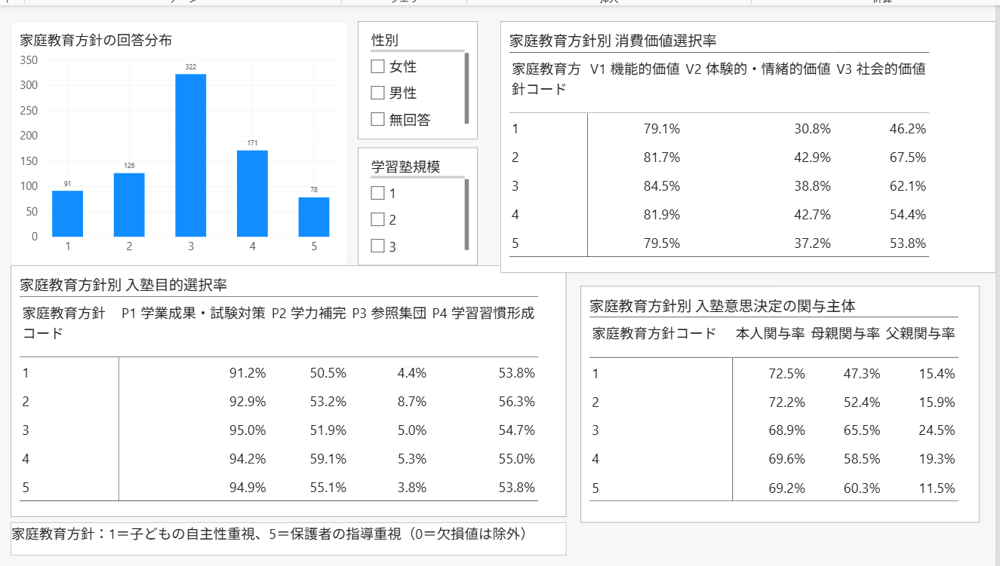
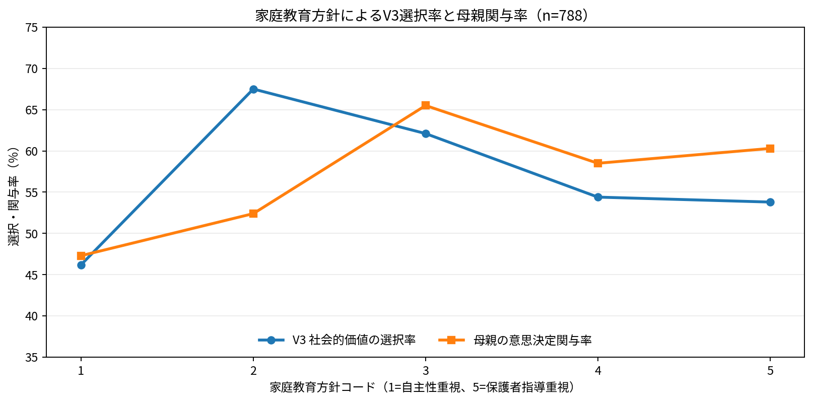
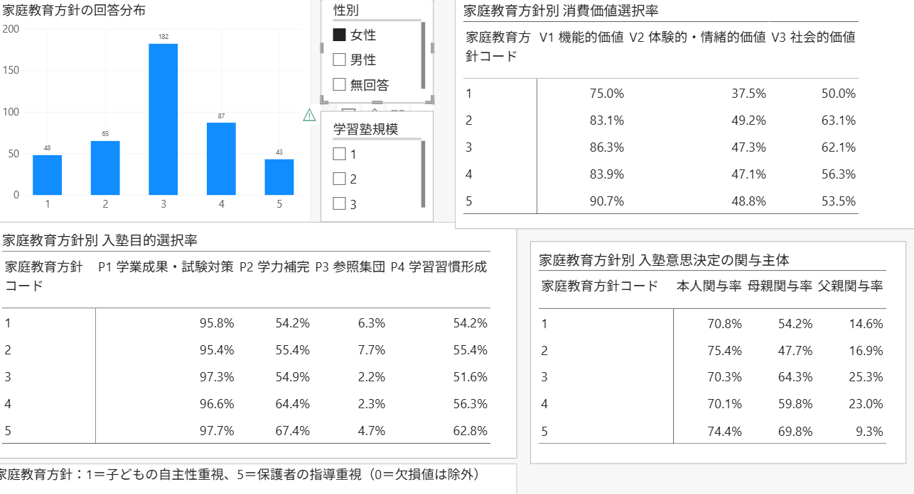
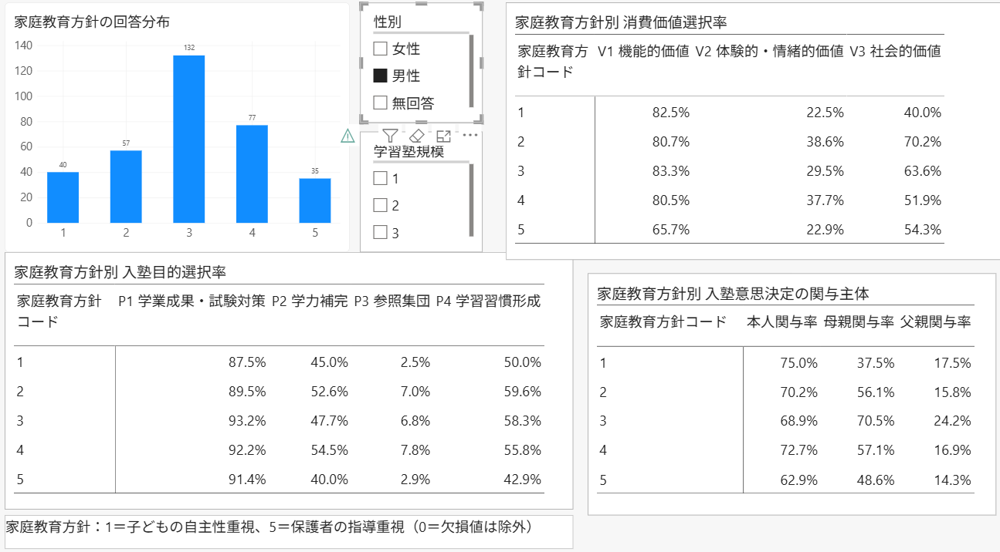
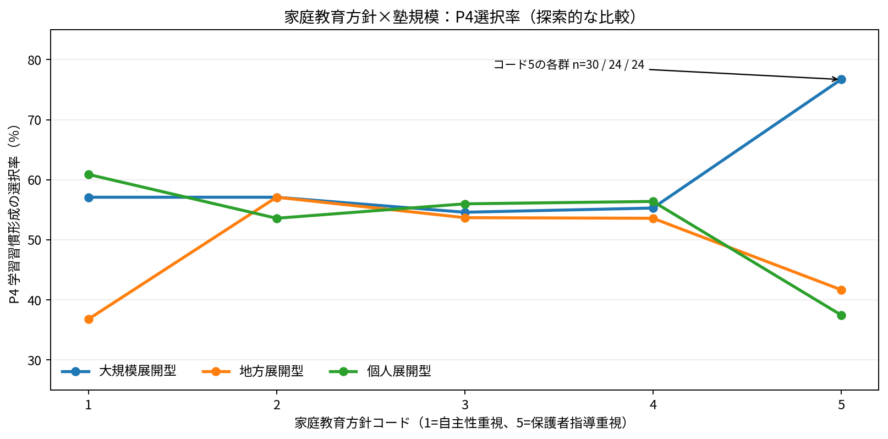

# 04. 分析3：家庭教育方針と消費価値・家族内意思決定

> **分析上の問い（Q3）：家庭教育方針によって、学習塾選択時に重視する価値や、生徒本人・保護者の意思決定への関与は異なるのか。**  
> 経営課題：新規入塾者獲得に向けて、誰に・どのような情報を伝えるかを検討する。

[← 03. 消費価値の普及度と特徴度](03_coverage_lift.md) ｜ [01. ビジネス課題](01_business_problem.md) ｜ [トップページ](../README.md)

## 1. 分析結果の要約

修士論文では、学習塾選択への関与主体は生徒本人（70.1%）と母親（59.0%）が中心であることを示した。本分析では、同じ調査の「家庭教育方針」を追加し、入塾目的・消費価値・家族内意思決定関与の違いを検討した。

- **社会的価値（V3）：** 家庭教育方針コード別の選択率は46.2〜67.5%であった。5区分とV3選択有無の関連は、全体集計からの暫定的なカイ二乗検定でχ²(4)=13.51、p=.009、Cramér's V=.131となり、関連は小さい。
- **母親の関与：** 家庭教育方針コード別の関与率は47.3〜65.5%。同様の検定はχ²(4)=13.22、p=.010、Cramér's V=.130であり、関連は小さい。
- **入塾目的：** P1（学業成果・試験対策）は全コードで9割以上。P4（学習習慣形成）も全体ではコードによる明確な差が見られず、χ²(4)=0.19、p=.996であった。
- **属性別探索：** 男性では家庭教育方針とV3・母親関与の関連が見られたが、性別による交互作用は有意ではなかった。塾規模別では「保護者指導重視（コード5）」のP4選択率に違いが見られたものの、5区分全体×塾規模の交互作用は有意ではなかった。

**結論：** 家庭教育方針を本人・母親・父親の関与や価値志向と併せて把握することは、入塾面談での情報提供を考える手掛かりとなる。ただし、家庭教育方針のコードが増えるほど指標が単調に変化するわけではなく、本人・保護者の役割を属性のみで決めつける根拠にはならない。

> **検証状況：** 本レポートの検定値は、Power BI画面に表示された各コードの人数と、小数第1位までの選択率から選択人数を復元して再計算したもの。元データの個票との照合前であり、p値は多重比較補正前の探索的な値である。

## 2. 分析の背景と目的

修士論文は、学習塾選択において生徒本人と母親が主要な関与主体であり、入塾時期によって本人・母親の関与状況が異なる可能性を示した。一方、意思決定への関与が家庭の教育方針とどう関連するかは、追加的な検討の余地がある。

教育サービスでは、実際に授業を受ける生徒と、費用負担や入塾への助言を行う保護者が異なることがある。新規入塾者の募集では、**「どのような価値を訴求するか」だけでなく「誰に向けて、どの情報を提供するか」** を判断する必要がある。

そこで分析3では、次の点を確認する。

1. 家庭教育方針によって、入塾目的（P1〜P4）や消費価値（V1〜V3）の選択率は異なるか。
2. 家庭教育方針によって、生徒本人・母親・父親の関与率は異なるか。
3. これらの関係は、性別・学習塾の展開規模によって異なる可能性があるか。

## 3. データと変数の定義

- **調査対象：** 新潟市内の模擬試験会場で調査した、学習塾に通う中学3年生795人（2025年10月5日）。
- **家庭教育方針：** 1＝子どもの自主性重視、5＝保護者の指導重視。2〜4はその中間段階、0は欠損値として除外。
- **分析対象人数：** 家庭教育方針の有効回答788人（7人はコード0）。性別比較では女性425人・男性341人、計766人。残る22人は性別が無回答。
- **学習塾規模別：** 家庭教育方針有効回答のうち、大規模展開型370人、地方展開型229人、個人展開型189人。
- **入塾目的・消費価値：** P1〜P4、V1〜V3の分類は[分析1：第3章](02_purpose_value.md)と同じ。複数回答のため各分類の選択率の合計は100%とならない。
- **意思決定関与：** 生徒本人、母親、父親の各項目を「関与あり＝1／なし＝0」として集計。こちらも複数回答である。

### 3.1 家庭教育方針の回答分布

| コード | 教育方針の方向 | 人数 | 構成比（788人に対して） |
|---:|---|---:|---:|
| 1 | 子どもの自主性重視 | 91 | 11.5% |
| 2 | 自主性重視寄り | 126 | 16.0% |
| 3 | 中間 | 322 | 40.9% |
| 4 | 保護者指導重視寄り | 171 | 21.7% |
| 5 | 保護者の指導重視 | 78 | 9.9% |
| **合計** | | **788** | **100.0%** |

コード3が322人と最も多く、コード1・5は相対的に少ない。特に属性と掛け合わせる場合は、該当人数を併記する必要がある。

## 4. 分析方法とPower BIによる可視化

家庭教育方針コードごとに、P・Vの該当者数を当該コードの回答者数で除した**選択率**と、意思決定関与主体ごとの**関与率**を算出した。Power BIには家庭教育方針の人数分布、消費価値、入塾目的、意思決定関与の4つの視覚化を配置し、性別・学習塾規模のスライサーで比較した。



*図1：分析3のPower BI画面。家庭教育方針の有効回答788人に関する分布と選択・関与率。*

主要な計算式（関与率）の例：

```dax
母親関与率 =
DIVIDE(
    CALCULATE([回答者数], '回答者データ'[関与者_母] = 1),
    [回答者数]
)
```

家庭教育方針コード0をページまたはビジュアルのフィルターから除外し、選択率・関与率の分母がフィルター後の回答者数であることを確認する。

統計的検証では、コード1〜5×各指標の選択有無について5×2分割表を復元し、Pearsonのカイ二乗検定（自由度4）を行った。効果量はCramér's V、属性間の関連の違いは二項ロジスティック回帰の交互作用に対する尤度比検定を用いた。

## 5. 全体の分析結果（家庭教育方針有効回答 n=788）

### 5.1 消費価値の選択率

| 家庭教育方針 | n | V1 機能的 | V2 体験的・情緒的 | V3 社会的 |
|---:|---:|---:|---:|---:|
| 1 | 91 | 79.1% | 30.8% | 46.2% |
| 2 | 126 | 81.7% | 42.9% | **67.5%** |
| 3 | 322 | 84.5% | 38.8% | 62.1% |
| 4 | 171 | 81.9% | 42.7% | 54.4% |
| 5 | 78 | 79.5% | 37.2% | 53.8% |

V1は全コードで約8割を占め、比較的広く重視される。一方、V3はコード1が46.2%、コード2が67.5%で**21.3ポイントの差**がある。ただしコード3〜5では一方向の増減が見られず、家庭教育方針の単純な序列でV3の選択を説明することは難しい。

### 5.2 入塾目的の選択率

| 家庭教育方針 | P1 学業成果・試験対策 | P2 学力補完 | P3 参照集団 | P4 学習習慣形成 |
|---:|---:|---:|---:|---:|
| 1 | 91.2% | 50.5% | 4.4% | 53.8% |
| 2 | 92.9% | 53.2% | 8.7% | 56.3% |
| 3 | 95.0% | 51.9% | 5.0% | 54.7% |
| 4 | 94.2% | 59.1% | 5.3% | 55.0% |
| 5 | 94.9% | 55.1% | 3.8% | 53.8% |

P1は全コードで91〜95%程度と高い。P2はコード4で59.1%と最も高いが、単調な傾向ではない。P3は該当率が低いため、少人数の変動に左右されやすい。P4は全コードで53.8〜56.3%とほぼ同水準である。

### 5.3 意思決定関与主体の関与率

| 家庭教育方針 | 本人 | 母親 | 父親 |
|---:|---:|---:|---:|
| 1 | 72.5% | **47.3%** | 15.4% |
| 2 | 72.2% | 52.4% | 15.9% |
| 3 | 68.9% | **65.5%** | 24.5% |
| 4 | 69.6% | 58.5% | 19.3% |
| 5 | 69.2% | 60.3% | 11.5% |

本人関与率は68.9〜72.5%で比較的安定している。母親関与率はコード1で47.3%、コード3で65.5%と差が見られる。家庭教育方針が保護者の指導重視に近いほど、母親の関与率が単調に高くなるわけではない。



*図2：各コードのV3選択率と母親関与率。いずれも非単調な変化を示している。異なるアウトカムのため、2本の線は単純に同一の意味として比較しない。*

## 6. 性別による探索的比較



*図3：女性（家庭教育方針有効回答425人）。*



*図4：男性（家庭教育方針有効回答341人）。*

### 6.1 家庭教育方針別のV3選択率

| 家庭教育方針 | 女性（n=425） | 男性（n=341） |
|---:|---:|---:|
| 1 | 50.0% | 40.0% |
| 2 | 63.1% | 70.2% |
| 3 | 62.1% | 63.6% |
| 4 | 56.3% | 51.9% |
| 5 | 53.5% | 54.3% |

家庭教育方針とV3選択の関連は、男性内でp=.018、女性内でp=.469であった。しかし、**性別×家庭教育方針の交互作用はp=.742**であり、男女で関連の強さや形が異なると結論づける統計的証拠は認められなかった。

### 6.2 家庭教育方針別の母親関与率

| 家庭教育方針 | 女性（n=425） | 男性（n=341） |
|---:|---:|---:|
| 1 | 54.2% | 37.5% |
| 2 | 47.7% | 56.1% |
| 3 | 64.3% | 70.5% |
| 4 | 59.8% | 57.1% |
| 5 | 69.8% | 48.6% |

母親関与は男性内でp=.002、女性内でp=.096であったが、交互作用はp=.080であり5%水準では有意ではなかった。特にコード1と5の男女差は探索的な特徴として扱い、性別を理由に説明対象を固定することは避ける。

> **注意：** 「男性では有意、女性では非有意」だけでは、男女差の有意性を示すことにはならない。性別間の違いは交互作用で判断する。

## 7. 学習塾規模別の探索的比較

家庭教育方針とP4（学習習慣形成）の関係を学習塾規模別に確認した。特にコード5（保護者指導重視）の選択率は以下のとおりである。

| 学習塾規模 | 家庭教育方針コード5の人数 | コード5のP4選択人数 | P4選択率 |
|---|---:|---:|---:|
| 大規模展開型 | 30 | 23 | **76.7%** |
| 地方展開型 | 24 | 10 | 41.7% |
| 個人展開型 | 24 | 9 | 37.5% |



*図5：塾規模別のP4選択率。コード5は各群の人数が24〜30人と少ない。*

家庭教育方針5区分×塾規模3区分の交互作用を検証したところ、**χ²(8)=11.91、p=.155**であり、有意な交互作用は確認されなかった。一方、観察されたコード5の特徴に注目し、コード5とコード1〜4を事後的に比較した探索的な検定では、交互作用p=.0092であった。

後者は、**結果を見てからコード5に着目した事後分析**であり、多重比較・選択的検証の影響を受ける。したがって、本結果から「保護者指導重視の家庭には大規模塾が適している」「大規模塾で学習習慣形成の訴求が必ず有効」と結論づけることはできない。

## 8. 統計的検証のまとめ

以下は表示値を復元した暫定的な推定であり、いずれも多重比較補正前である。

| 対象 | 検定 | 結果 | 解釈 |
|---|---|---|---|
| 方針5区分×V3 | Pearson χ² | χ²(4)=13.51、p=.009、V=.131 | 関連は小さい |
| 方針5区分×母親関与 | Pearson χ² | χ²(4)=13.22、p=.010、V=.130 | 関連は小さい |
| 方針5区分×P4 | Pearson χ² | χ²(4)=0.19、p=.996、V=.015 | 全体では関連を検出せず |
| 方針×V3の性別差 | ロジスティック回帰交互作用 | χ²(4)=1.96、p=.742 | 男女差の証拠なし |
| 方針×母親関与の性別差 | ロジスティック回帰交互作用 | χ²(4)=8.34、p=.080 | 5%水準で有意ではない |
| 方針×P4の塾規模差 | ロジスティック回帰交互作用 | χ²(8)=11.91、p=.155 | 全体交互作用は有意でない |
| コード5対1〜4×塾規模（事後） | ロジスティック回帰交互作用 | χ²(2)=9.37、p=.0092 | 探索的・未補正 |

*方法：各コードの人数×画面表示率を四捨五入して整数の選択人数を復元した。表示率は小数第1位に丸められているが、整数人数に矛盾がないことを確認した。各指標をどの範囲で検定するかという検定族の定義、多重比較補正、元データとの照合は正式公開前の作業とする。*

## 9. 生徒募集マーケティングへの示唆

### 9.1 入塾面談では、生徒本人と保護者の双方の期待を確認する

本人関与率は家庭教育方針によらず約7割を維持している。母親関与率はコードにより変化するため、生徒と保護者の双方に希望や不安を確認する面談設計が考えられる。**一方を一律に意思決定者と決めつけないこと**が重要である。

### 9.2 情報提供内容は、家庭の方針ではなく具体的なニーズに合わせる

家庭教育方針とV3選択の関連は見られるが、単純な単調関係ではない。家庭教育方針だけで推薦や友人関係への訴求を決めるのではなく、本人が重視する項目を直接聞き取る。分析1・2で確認した入塾目的と消費価値の関係も組み合わせる。

### 9.3 施策仮説は面談・体験授業で検証する

| 施策仮説 | 具体的な実施案 | 測定指標（KPI） |
|---|---|---|
| 本人・保護者の期待を分けて把握する | 入塾面談で本人の希望と保護者の期待をそれぞれ確認 | 面談後の体験授業申込率、入塾転換率 |
| 重視価値に合わせて説明内容を調整する | 指導内容・学習成果の基本説明に、必要に応じて教室体験・講師との相性・紹介情報を加える | 説明パターン別の体験参加率・入塾率 |
| 家庭教育方針の異なる層への伝え方を検討する | 本人の自主性・家庭内役割について質問し、本人・保護者双方が理解できる資料を用意 | 本人・保護者別の説明理解度、相談満足度 |

**施策効果は現データから推定できない。** 実際の募集現場で、広告・問い合わせ・面談・体験・入塾の各段階を追跡し、比較検証する必要がある。

## 10. 分析の限界・公開前の確認

1. **対象集団：** 既存通塾者の中学3年生に限定される。未入塾者や潜在顧客の代表性は保証されない。
2. **横断的・回顧的調査：** 入塾時点の家庭教育方針や関与状況を前向きに測定したものではなく、因果関係は推定できない。
3. **多重比較・事後分析：** 複数の指標と属性を探索しているため、未補正のp値を確証的な結果と解釈できない。
4. **小標本：** コード5をさらに性別や塾規模で分割すると、該当人数が数十人となり、推定値が不安定になりやすい。
5. **公開許可と再現性：** 修士論文に記載された調査目的と二次利用の許可範囲を確認する。個票・個人を特定できる情報は掲載せず、公開可能な集計結果のみ扱う。元データからの人数・検定の再計算を今後実施する。
6. **既存分析との整合性：** V3の人数について修士論文の表9・表10とPower BIに不一致があるため、採用項目と集計条件の確認が必要である。

## 11. 参照資料

- 筆者（2026）『教育サービス選択における消費者行動論的アプローチ―学習塾選択に関する実証分析―』。家族内意思決定に関する検討を参照。
- 筆者作成のPower BI「家庭教育方針別 消費価値選択率・入塾目的選択率・意思決定関与率」（全体・性別・塾規模別の画面）。
- 本稿の集計・統計検証は、Power BI画面に表示された人数・小数第1位までの割合からの復元計算に基づく暫定値。
