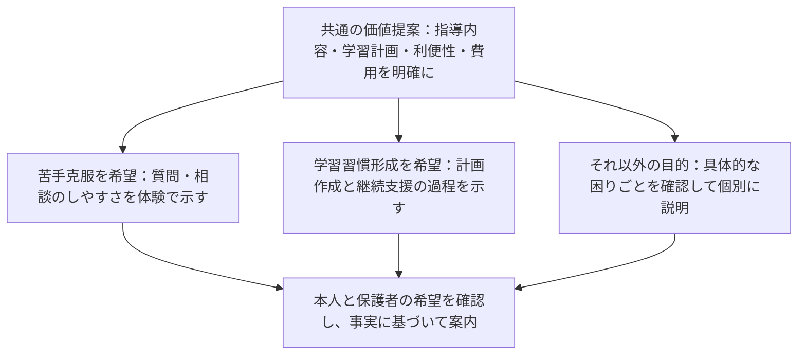
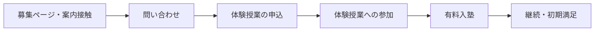

# 05. 総合考察：新規入塾者獲得に向けたマーケティング戦略案

> **経営上の意思決定：どの見込み顧客に、どの価値を、誰に向けて、どの接点で訴求するか。**  
> **位置づけ：分析1〜3の調査結果から導く施策仮説と、その実地検証計画。**

[← 04. 家庭教育方針と家族内意思決定](04_family_decision.md) ｜ [01. ビジネス課題](01_business_problem.md) ｜ [トップページ](../README.md)

## 1. エグゼクティブサマリー

本プロジェクトが提案するのは、**機能的価値をすべての見込み顧客に提示し、そのうえで本人が申告する入塾目的に応じて体験的・情緒的価値を追加する「共通訴求＋目的別訴求」**である。さらに、生徒本人と保護者の双方に希望を確認する面談を設計する。

この提案の根拠は次の3点にある。

1. **共通の価値：** 既存通塾者795人の調査では、機能的価値（V1）を655人（82.4%）が選択した。入塾目的別のカバー率も81.8〜86.6%であり、指導内容、利便性、料金などを基本情報として提示する方針を支持する。
2. **追加して検証したい価値：** 学力補完（P2）×体験的・情緒的価値（V2）は共起213人・目的内カバー率50.1%・リフト1.29、学習習慣形成（P4）×V2は206人・47.4%・1.21だった。講師との関係や教室の雰囲気などを具体化した訴求を**検証候補**にできる。
3. **伝える相手：** 学習塾選択への関与として本人70.1%、母親59.0%、父親19.6%が報告された（複数回答）。家庭教育方針別にも母親の関与率に違いが見られたが、単調な関係ではない。生徒と保護者のどちらか一方に決め打ちせず、相談時に双方のニーズと役割を確かめる。

**推奨する最初の意思決定：** ①基礎情報の提示を標準化し、②見込み顧客の入塾目的を問い合わせ時に任意回答で把握し、③P2・P4に相当する相談者を中心に訴求内容を比較する小規模な実地テストを行う。**施策による入塾率・売上の上昇は、現時点では実証されていない。**

## 2. 経営課題と意思決定の範囲

### 2.1 対象とする経営課題

学習塾の収益には在籍生徒数が関係し、在籍生徒数を維持・拡大する経路の一つが新規入塾者の獲得である。本報告書は、[ビジネス課題の整理](01_business_problem.md)で設定した「新規入塾者獲得に向けたマーケティング施策の最適化」に対象を絞る。価格戦略、既存在籍者の退塾防止、講師配置の最適化などは本稿の主要対象ではない。

想定利用者は、学習塾の経営者、教室責任者、募集・広報担当者である。判断すべき項目は、**募集メッセージ、体験授業の内容、入塾面談の進め方、施策を続けるかどうか**である。

### 2.2 根拠となる調査の範囲

分析の基礎は、2025年10月5日に新潟市内の模擬試験会場で収集した、**学習塾に通う中学3年生795人の質問紙調査**である。入塾目的（P1〜P4）、重視する消費価値（V1〜V3）、家族内意思決定への関与、家庭教育方針などを用いた。

これは**既存通塾者の横断的・回顧的な自己報告**である。未入塾者のニーズ、広告接触、体験授業の申込、入塾転換、顧客獲得単価を測ったデータではない。そのため以下では「観察された事実」と「そこから考えられる施策仮説」を区別する。

## 3. 分析1〜3からの統合的な示唆

| 分析 | 調査から観察された事実 | 経営判断に向けた解釈 | 確認が必要なこと |
|---|---|---|---|
| [分析1：入塾目的と消費価値](02_purpose_value.md) | P2×V2のリフト1.29、P4×V2は1.21。V1は各Pに対しリフト約1 | 特定目的の相談者にV2を加えた訴求を試す余地がある | そのメッセージが未入塾者の申込行動を変えるか |
| [分析2：普及度と特徴度](03_coverage_lift.md) | V1は各Pでカバー率81.8〜86.6%。P2×V2は50.1%、P4×V2は47.4% | V1を共通基盤、V2を目的別の追加要素として扱う | 申込者数、費用、顧客ニーズに照らした優先順位 |
| [分析3：家庭教育方針と関与主体](04_family_decision.md) | 本人70.1%、母親59.0%、父親19.6%が関与。家庭教育方針との関連は単純でない | 生徒と保護者双方の期待を確認し、伝える内容を調整する | 面談設計が参加率・納得度・入塾に影響するか |

**集計の解釈：** P1〜P4とV1〜V3はそれぞれ複数選択可能であり、排他的な顧客分類ではない。例えばP2×V2の213人とP4×V2の206人を足して「419人の異なる顧客」とはみなせない。また、共起リフトは入塾転換率の倍率ではない。

### 3.1 属性別分析は施策対象の固定化に用いない

分析2では、P2・P4×V2の**カバー率は女性の方が高く、リフトは男性の方が高い**という違いがあった。これは男女のV2基準選択率が異なることと整合的であり、「男性の方がV2を多く重視する」という意味ではない。中1入塾者や学習塾規模別にも探索的な特徴があったが、群間の交互作用や施策効果を確証したものではない。

したがって、性別・入塾時期・塾規模による機械的な広告配信や、個人の価値観の推定は行わず、**問い合わせ時に本人・保護者が実際に表明した入塾目的**を第一の手掛かりにする。

## 4. STPの視点からの戦略設計

### 4.1 Segmentation：入塾目的を起点とする

| 入塾目的 | 見込み顧客から確認したい課題 | 初期仮説となる価値訴求 | 注意点 |
|---|---|---|---|
| P1：学業成果・試験対策 | 定期テスト、入試対策、予習復習など何を優先するか | V1：指導方針、学習計画、授業形式、通いやすさ、費用 | P1は調査対象の94.0%に該当するため、差別化の根拠にはなりにくい |
| P2：学力補完（苦手克服） | 苦手教科・単元、質問のしやすさ、つまずきの状況 | V1を示したうえで、V2：講師との対話、質問しやすさ、体験時の安心感 | P2×V2は関連の記述であり、訴求の有効性は未検証 |
| P4：学習習慣形成 | 学習計画、家庭学習、継続の難しさ | V1を示したうえで、V2：学習相談、伴走、継続しやすい教室体験 | P2と重複する可能性がある |
| P3：参照集団の影響 | 友人・講師との交流を重視するか | V3：友人の通塾・推薦等への関心を丁寧に確認 | P3は44人、P3×V3は37人。分類概念の近さにも注意 |

**実務上の区分方法：** 問い合わせフォームで複数の入塾目的を選択できるようにし、必要なら「最も重視する目的」を追加で尋ねる。複数回答を無理に一つの属性に変換せず、テスト対象の割り当てだけは事前に定めた主目的に沿って行う。調査の既存回答者と新規問い合わせ者を同一集団とみなさない。

### 4.2 Targeting：優先して検証する対象

**第1優先：P2（苦手克服）を主目的として申告した見込み顧客。** 調査内のP2×V2は213人で、カバー率50.1%、リフト1.29。サンプル数と特徴度の両面から、機能的価値のみの場合とV2を加えた場合の比較に適していると考える。

**第2優先：P4（学習習慣形成）を主目的として申告した見込み顧客。** P4×V2は206人、カバー率47.4%、リフト1.21。学習方法や継続支援を伝える体験授業の検証候補となる。

**全対象共通：** P1も含む見込み顧客に対してはV1の基本情報を欠かさない。P3×V3は高リフト（1.43）だが標本が小さく、独立した大規模募集施策としては優先しない。

この優先順位は、**調査上の関連と施策の実行しやすさに基づく仮の順位**である。実際の顧客数、商圏、競合、校舎の提供可能なサービス、予算、利益率を評価した結果ではない。

### 4.3 Positioning：共通価値と目的別価値を重ねる

ここでのポジショニングは**実施予定の価値提案**である。「成績が必ず向上する」「必ず習慣が身につく」など、実証していない成果を広告文に用いることは避ける。

## 5. 顧客接点ごとの施策案

### 5.1 募集ページ・案内資料

すべての見込み顧客に対し、実際に提供している授業形式、対象学年、指導方針、時間割、料金、通塾方法などを確認しやすく提示する。そのうえで、入塾目的別に説明の入口を設ける。

| 対象 | 見出し例（作成案・実績主張ではない） | ページ・資料で示す具体的な内容 |
|---|---|---|
| 共通 | 「授業内容・学習計画・費用がわかる」 | 授業例、料金表、通塾の仕組み、担当者への質問窓口 |
| 苦手克服 | 「つまずいている単元から、一緒に学習方法を考える」 | 相談の流れ、講師への質問方法、体験授業の内容 |
| 学習習慣形成 | 「無理なく続けるための学習計画を相談する」 | 計画づくりの例、進捗確認の方法、家庭での学習相談 |

※具体的な指導内容や制度は、実在する学習塾の提供条件と照合してから掲載する。現在の分析は、これらの表現の効果を測定していない。

### 5.2 体験授業・学習相談

- **P2向けの施策仮説：** 体験前に苦手単元を聞き取り、授業で疑問を質問できる機会を設け、授業後に本人の理解と不安を確認する。
- **P4向けの施策仮説：** 体験前に家庭学習の困りごとを聞き取り、短い学習計画を一緒に作成し、継続支援の仕組みを説明する。
- **共通の確認：** 本人が授業や講師との相性をどう感じたか、保護者が内容・費用・通塾負担をどう考えたかを別々に確認する。

体験授業の設計は、V2の内容を**実際に体験できる接点**へ落とし込むための仮説である。体験時間や料金、担当講師の配置など運営面の制約も評価する。

### 5.3 入塾面談：本人と保護者の期待をそれぞれ把握する

面談では、最初に「何のために通いたいか」「どのような場面で困っているか」を本人に確認する。次に保護者に学習上の期待、送迎や費用などの条件を確認し、両者の希望に違いがあればそのまま記録する。家庭教育方針や性別のみから、意思決定者・重視価値を決めつけない。

紹介・口コミを重視するかどうかも個別に確認できるが、**友人の推薦は広告効果の実測値ではない**。紹介制度を導入する場合も、過度な勧誘や事実と異なる推薦表示は避ける。

## 6. 施策優先順位と実施条件

| 優先 | 施策 | 調査からの根拠 | 実施に必要な条件 | 最初に確認する結果 |
|---|---|---|---|---|
| **A：基本整備** | V1の基本情報を整理・掲載 | V1全体82.4%、各目的で高カバー率 | 正確な料金・サービス情報、更新担当 | 必要情報を理解できるか、問い合わせへの移行状況 |
| **A：最初の検証** | 苦手克服の相談者にV2を追加した案内を比較 | P2×V2：50.1%、リフト1.29 | 目的の事前確認、2案の提示、記録可能な申込動線 | 問い合わせ後の体験申込・入塾転換 |
| **B：並行または第2段階** | 学習習慣形成の相談者向け体験・案内 | P4×V2：47.4%、リフト1.21 | 計画作成・継続支援を実際に提供できること | 体験参加・入塾転換・初期継続 |
| **B：接点改善** | 本人と保護者の希望を確認する面談票 | 本人70.1%、母親59.0%が関与 | 面談運用、同意を踏まえた記録方法 | 面談完了、双方の納得度、入塾転換 |
| **C：小規模探索** | 紹介・友人との体験機会の訴求 | P3×V3：37人、リフト1.43 | 対象規模・分類定義の確認 | 需要の有無と適切な運用の検討 |

優先度は**導入順を決めるための定性的な提案**であり、費用対効果や予測収益に基づくランキングではない。新規問い合わせ者の数が少ない場合は、複数のテストを同時に行わず、施策を順次検証する。

## 7. 実地検証：問い合わせから入塾までの計測設計

### 7.1 顧客行動のファネル

各段階は**実施時に新たに取得すべき行動データ**であり、本研究の795人の質問紙調査には含まれない。ファネル集計では、同じ問い合わせコホートを追跡し、重複した問い合わせや体験を人数として二重計上しない。

### 7.2 KPIの定義

| KPI | 定義（基本単位はユニークな見込み顧客） | 主な用途・留意点 |
|---|---|---|
| 問い合わせ率 | 問い合わせに至った人数 ÷ 対象ページの訪問者数 | ページ施策の評価。流入元と計測期間を揃える |
| 体験申込率 | 体験を申し込んだ人数 ÷ 問い合わせ人数 | 案内や面談後の意向の評価 |
| 体験参加率 | 体験に参加した人数 ÷ 体験申込人数 | 予約と参加を分けて把握する |
| 体験後入塾率 | 有料入塾した人数 ÷ 体験参加人数 | 体験内容の検証に用いる。途中段階の選抜に注意 |
| **問い合わせからの入塾転換率** | **所定期間内に有料入塾した人数 ÷ 問い合わせ人数** | **施策比較での主要な最終指標の候補** |
| 顧客獲得単価（CAC） | 対象施策に帰属させた募集・制作・運営費 ÷ 新規有料入塾者数 | 費用範囲と帰属ルールを事前定義。入塾者0人では算出不可 |
| 初期継続率 | 入塾後の所定時点で継続している人数 ÷ 観測可能な新規入塾者数 | 短期獲得の質を確認する補助指標 |

母数は施策開始時点・問い合わせ時点・体験時点で異なるため、異なるコホートの人数を単純につないだ「転換率」を計算しない。たとえば問い合わせから30日以内の有料入塾を成果とする場合は、**全群で同じ30日間を追跡できた見込み顧客**のみで確定値を出す。30日はここでの**測定窓の例**であり、実務の入塾検討期間に応じて事前に決定する。

### 7.3 優先テストA：苦手克服を主目的とする相談者

**仮説 H1：** V1の基本説明だけを提示する場合と比べて、V1にV2の体験的要素（質問しやすさ・講師との対話・教室体験）を追加すると、問い合わせ後の体験申込や入塾転換に違いが生じる。

| 設計要素 | 提案 |
|---|---|
| 対象 | 問い合わせ時点で「苦手克服」を主目的と申告した見込み顧客 |
| 対照群 A | 指導方針・学習計画・費用等、V1中心の標準案内 |
| 比較群 B | Aと同一の事実情報に、講師との対話・体験内容等のV2情報を追加 |
| 割り付け | 対象者を事前に無作為に割り付ける。複数の目的がある場合も、割り付け前に主目的を固定する |
| 主要評価指標 | 問い合わせから所定期間内の有料入塾転換率（事前登録）。件数が足りない場合は実施可能性を中心に評価 |
| 補助指標 | 体験申込率、参加率、面談満足度、CAC、講師負荷 |
| 判定 | 主要指標の群間差・不確実性・費用・運用負担を併せて判断。母数と観測期間を揃える |

**重要：** 標本795人からテストの必要サンプル数や効果量を決めることはできない。実施校舎の既存の入塾転換率、検出したい最小差、許容誤差、テスト期間から事前にサンプルサイズを設計する。少数例では統計的に結論を出さず、予備実験と位置づける。無作為化後の比較では、途中段階で発生した人数だけでなく、原則として割り付けた集団全体の成果を追う。

### 7.4 優先テストB：学習習慣形成の相談者

**仮説 H2：** 学習習慣形成を主目的とする相談者に対して、通常の指導内容説明に「計画作成のミニ体験」「進捗確認の流れ」の説明を追加すると、体験申込率や入塾転換率に違いが生じる。

対象者を問い合わせ時点に定義し、原則はテストAと同様の比較設計を用いる。**P2・P4を併せて選ぶ人がいる**ため、主目的の決定ルールと同じ見込み顧客を両テストへ重複登録しないルールを事前に作る。

### 7.5 面談設計の検証

生徒と保護者の期待をそれぞれ聞き取る**構造化された面談票**を試行し、現行方式と比較できるなら、面談完了率、説明内容の理解度、相談満足度、入塾転換率を確認する。本人・保護者の参加はそれぞれの事情を尊重し、参加しなかったことを不利益に扱わない。分析3の家庭教育方針別集計から面談改善の効果を推定したものではない。

## 8. 運用に必要なデータと更新方法

### 8.1 最小限の計測項目

| 単位 | 項目例 | 目的 |
|---|---|---|
| 見込み顧客 | 仮名化した `lead_id`、初回問い合わせ日、申告された入塾目的・主目的 | 重複排除、目的別集計、コホート定義 |
| 流入・施策 | 流入チャネル、施策ID、割り付け群、接触日 | 施策比較と帰属の確認 |
| 顧客行動 | 体験申込日時、体験参加日時、初回有料入塾日 | ファネルと入塾転換率の算出 |
| 運用 | 施策費用、担当時間、体験枠の空き状況 | CAC・負荷・運営制約の評価 |
| 任意のフィードバック | 本人と保護者の説明理解度・満足度 | 価値訴求の受け止め方の確認 |

個人情報を含む氏名・連絡先等は適切に管理し、分析・公開用データから分離する。未成年者や保護者の回答は、利用目的や同意範囲を明確にしたうえで必要最小限にとどめる。**GitHubには個票、連絡先、追跡可能な顧客IDを掲載しない。**

### 8.2 推奨する集計・可視化

Power BI等で、問い合わせ月×主目的×施策群について、**問い合わせ人数 → 体験申込人数 → 体験参加人数 → 有料入塾人数**を同じコホートで表示する。加えて各段階の転換率、募集費用、CAC、施策別のサンプルサイズを追跡する。

効果検証の際は、問い合わせの季節性、校舎差、体験の受け入れ余力、価格・講師配置、キャンペーン条件の違いなどを記録する。単純な施策前後比較だけで因果効果を断定しない。

## 9. 段階的な実装ロードマップ（提案）

| 段階 | 実施内容 | 次段階へ進む条件 |
|---|---|---|
| **0：調査と公開の整合確認** | 論文・Power BIの集計定義、消費価値V1/V3の人数差、公開許諾を確認 | 根拠データの扱いを説明でき、公開範囲が明確になる |
| **1：現場課題の確認** | 教室責任者に募集上の課題を聞き取り、現行の問い合わせ〜入塾データを整理 | 顧客獲得の主要なボトルネックと計測可能性が分かる |
| **2：共通情報の整備** | V1の基本情報・料金・体験内容を整理し、入塾目的の任意回答を導入 | 情報の正確性と目的別の記録精度を確保できる |
| **3：小規模な比較検証** | P2を主目的とする相談者を中心にV2追加訴求をテスト。必要に応じてP4も検討 | 母数・主要指標・運用負荷・費用を確認できる |
| **4：判断と改善** | 実地データを用いて継続・修正・停止を決定し、必要なら再テスト | 実施可否と追加検証の必要性が判断できる |

このロードマップは**実施提案**であり、特定の学習塾ですでに実施した施策や達成した成果を表していない。

## 10. 分析上の限界・公開前に必要な確認

1. **外的妥当性：** 標本は新潟市の模試受験者かつ既存通塾者である。未入塾者・他地域・他学年の需要を代表しない。
2. **因果推論の限界：** 共起リフト、カバー率、関与率は訴求による入塾増加の因果効果を示さない。戦略は**実地テストで検証すべき仮説**である。
3. **分類の非排他性：** 複数の入塾目的・価値を選択できるため、人数を単純加算できない。P3・V3は概念が近く、少人数の組み合わせを過大評価しない。
4. **属性差の解釈：** 性別・入塾時期・塾規模別の比較は探索的であり、属性別の訴求優位性や群間差を確証していない。
5. **家庭教育方針の検定：** 分析3で示したp値は表示割合から復元した暫定集計・未補正の探索的結果であり、個票での照合が必要である。
6. **集計値の不整合：** 論文表9・表10（いずれも入塾時期有効回答792人）とPower BI全体795人の間で、V1・V3の人数が一致しない。原因が確定するまでは、影響する指標を最終確定値として扱わない。
7. **費用対効果の未測定：** 市場規模、問い合わせ数、入塾転換率、募集費用、利益率が不明であり、CAC・売上増分・投資回収額の推計は行わない。
8. **倫理と公開許可：** 調査時の利用目的と許諾範囲を確認し、二次利用や集計結果の公開を許可された範囲でのみ行う。それまでは**Privateで下書き**として扱い、個票・識別情報・少人数の詳細集計を公開しない。

## 11. 結論：データから施策仮説へ、施策仮説から効果検証へ

分析1〜3からは、**「機能的価値を基本情報として示す」「苦手克服・学習習慣形成には体験的・情緒的価値を追加して試す」「本人と保護者の双方の希望を確かめる」**という方向性が導かれる。

ただし、この方向性は既存通塾者の選択傾向に基づく。経営上の推奨は、いきなり募集予算を大きく投じることではなく、**まず現場での実行可能性と問い合わせ〜入塾までの計測基盤を整え、対照群を設けて小さく検証すること**である。その結果により、施策を継続・拡張・見直しするか判断したい。

本レポートの価値は、観察データの関連をそのまま効果とみなさず、**顧客理解 → 訴求仮説 → 運用設計 → KPIによる評価**までを一つの意思決定プロセスとして整理した点にある。

## 12. 参照資料と数値の出所

- [01：ビジネス課題と分析上の問い](01_business_problem.md)：経営課題の設定、修士論文の主要結果、データ範囲。
- [02：分析1 入塾目的と消費価値の共起分析](02_purpose_value.md)：P×Vの共起人数、共起リフト、分類定義、集計不整合。
- [03：分析2 消費価値の普及度と特徴度](03_coverage_lift.md)：目的内カバー率、リフト、性別・入塾時期・塾規模別の探索的比較。
- [04：分析3 家庭教育方針と家族内意思決定](04_family_decision.md)：意思決定関与、家庭教育方針別の選択率と探索的な検定。
- 修士論文（2026）『教育サービス選択における消費者行動論的アプローチ―学習塾選択に関する実証分析―』：調査方法、元の研究目的、各分類の検討。

**出所の区別：** 795人の選択率・共起人数・リフト・関与率は上記の修士論文・Power BI集計に基づく**観察値**。本稿の募集コピー、STP、優先順位、テスト設計、KPI、ロードマップは、それらをもとに筆者が提案する**施策仮説・計画**であり、実施済みの実績ではない。
